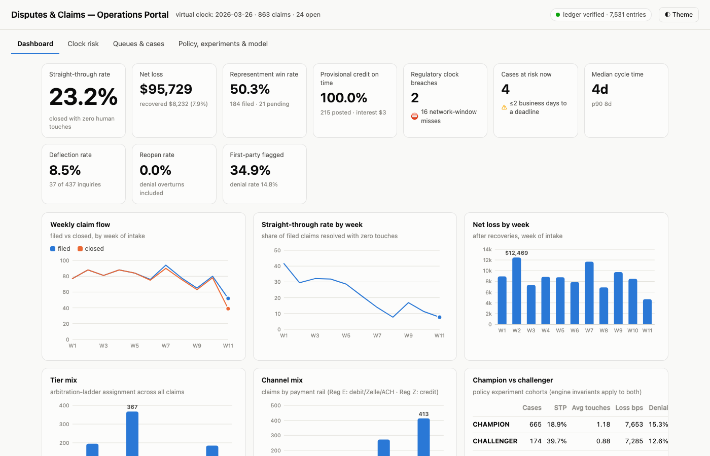
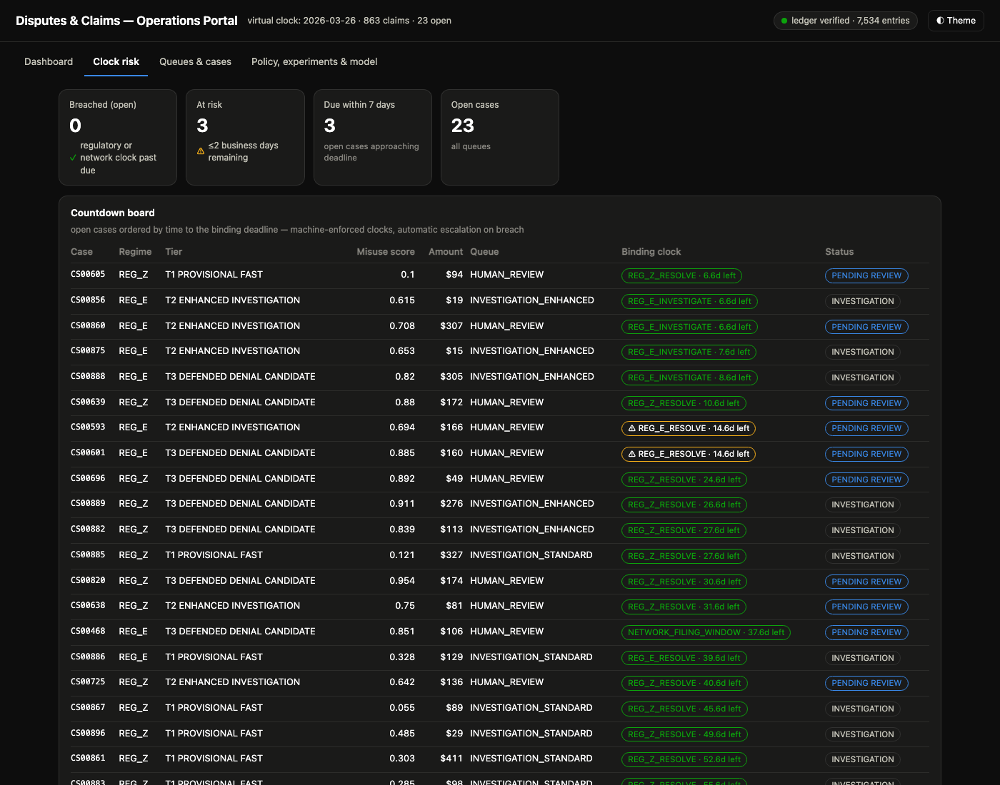
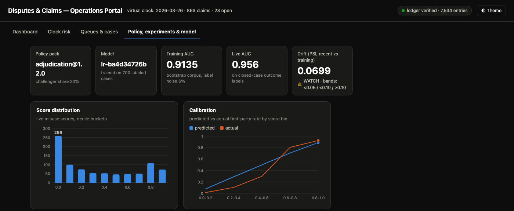

# Intelligent Disputes & Claims — Decision Engine + Operations Portal

**Author:** Sundaram Thevar · 2026

An AI-enabled operating model for the card-issuer dispute lifecycle, built as a
working system: a decision engine that triages, adjudicates, and evidences
disputes and claims, with an operations portal on top. It accompanies the paper
*Intelligent Disputes and Claims: An AI-Enabled Operating Model for the Dispute
Lifecycle at a Large Card Issuer*, which argues that a large issuer should rent
the network utilities, keep a case-management chassis, and **build the AI
decisioning layer and data foundation**: the layer that actually sets loss
rates, cost per case, and customer experience.

> This repository is a public showcase: screenshots and an overview. The source code is private.

## What it does

- **Regulatory timelines as a system property.** Every case carries
  machine-enforced Reg E, Reg Z, and card-network deadlines from the moment of
  intake, with at-risk warnings and automatic escalation, rather than relying on
  analyst diligence.
- **Provisional credit as a guarantee.** Consumer protections are executed as
  recorded policy decisions, never as silent side-effects.
- **First-party misuse detection at triage.** Each claim is scored for
  first-party misuse with explainable reason codes. The score informs policy; it
  never decides on its own.
- **Policy-as-code auto-adjudication.** Decision rules are versioned, reviewable
  data with champion/challenger experimentation, and safety invariants that sit
  outside any policy: **no automated denial, ever.**
- **Agentic evidence gathering.** Evidence is assembled with citations into a
  drafted investigator narrative, with a mandatory human checkpoint before any
  customer-adverse action.
- **Tamper-evident decision ledger.** Every action is recorded in an append-only,
  cryptographically chained ledger; a case's full history can be rebuilt from the
  ledger alone, which gives examiners a complete view.
- **A learning loop.** Closed cases feed back into the model, with live accuracy,
  calibration, and drift monitoring.
- **Pre-dispute deflection.** Merchant order data is used at the point of
  inquiry to resolve cases before they become chargebacks.

## Operations portal

Figures below come from a seeded synthetic simulation (about 900 claims over 80
virtual days), not from any real institution.

**Dashboard.** Straight-through rate, net loss and recovery, representment win
rate, provisional-credit timeliness, regulatory vs network breaches,
deflection, weekly trends, and champion-vs-challenger results.

<picture>
  <source media="(prefers-color-scheme: dark)" srcset="screenshots/dashboard_dark.png">
  
</picture>

**Clock risk.** A countdown board over every open case's binding regulatory or
network deadline.

**Model & policy monitoring.** Policy and model versions, training vs live
accuracy, drift status, score distribution, and calibration.

## Notes

All data is synthetic and deliberately realistic rather than flattering:
overlapping classes, label noise, and no leakage of post-filing information.
Nothing here describes any institution's production systems or real-world rates.

## Contact & license

Copyright © 2026 Sundaram Thevar. **All Rights Reserved.** No permission is
granted to use, copy, modify, or distribute any part of this material without
prior written approval. See [`LICENSE`](LICENSE). For enquiries or access
requests, contact [@sundaramx](https://github.com/sundaramx).
