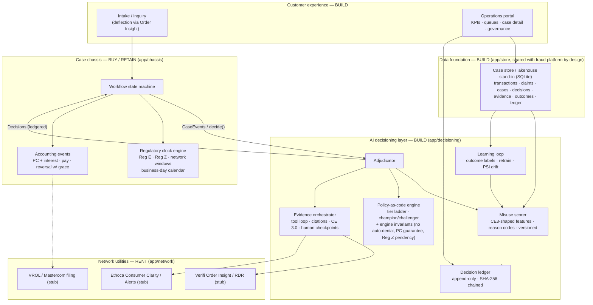

# Architecture

Implements the paper's Figure-2 layered target architecture with the sourcing
decision annotated per layer (build / buy-retain / rent).

## The narrow interface (paper §5)

The chassis and the decisioning layer never import each other — enforced by
`test_layer_boundary_*`. The orchestrator `app/engine.py` (and the API) is the only
module wiring both:

- chassis **emits** `ChassisEvent`s and `ClockEvent`s and **executes** `Decision`s;
- decisioning **consumes** case snapshots and **returns** `Decision`s, ledgering
  every one with policy version, model version, score, reason codes, and rule trace.

This is what makes the chassis swappable (vendor product, incumbent, or in-house)
without trapping the differentiating logic — the paper's core sourcing argument.

## Regulatory encodings

| Clock | Rule | Encoding |
|---|---|---|
| Reg E investigate | 12 CFR 1005.11(c): 10 bd (20 bd new account) | business-day calendar w/ observed federal holidays |
| Reg E extended resolve | 45 cd (90 cd POS/foreign/new) — **only if PC posted within the investigate window**, else the investigate deadline binds | `effective_rege_resolve_deadline()` |
| Reg E PC notice | 2 bd after posting | auto-satisfied at posting (notice issued with the credit) |
| Reg E correction / report | 1 bd / 3 bd after determination | started at determination |
| PC reversal | notice + 5 bd grace | human-only action |
| Reg Z ack / resolve | 30 cd; min(2nd cycle close, 90 cd) | real `cycle_close_day` math |
| Reg Z pendency | payment hold, finance-charge freeze, adverse-reporting block | activated at intake as a ledgered decision |
| Network filing | 120 cd from transaction | late filings refused → recovery forfeited (KPI) |
| VCR merchant response | 30 cd | started at chargeback filing |

## Engine invariants (outside all policy packs, all cohorts)

1. **INV-NO-AUTO-DENIAL** — no automated actor can deny or reverse PC; schema-level
   (policy packs cannot express it) and runtime-gated.
2. **INV-PC-GUARANTEE** — an at-risk Reg E investigate clock with no determination
   forces PC as a ledgered decision.
3. **INV-REGZ-PENDENCY** — Reg Z pendency protections activate at intake.

## Determinism & audit

Same seed ⇒ identical ledger head hash (tested). Ledger rows are self-contained
(canonical JSON payload in the row); `hash = SHA256(prev_hash | seq | ts |
event_type | canonical_payload)`; `/api/ledger/verify` recomputes the full chain.
The portal's case timeline renders exclusively from ledger rows.

## Production swap-in points

- `MockNetworkBackend` → real Verifi/Ethoca clients (interfaces stable).
- `EvidenceOrchestrator._draft_narrative` → LLM drafting over the same structured
  bundle; tool loop, citations, checkpoints, ledger unchanged.
- `MisuseModel` → gradient-boosted / graph model behind the same score+reasons API.
- `Store` → the shared lakehouse/feature store of the fraud platform (paper §5).
